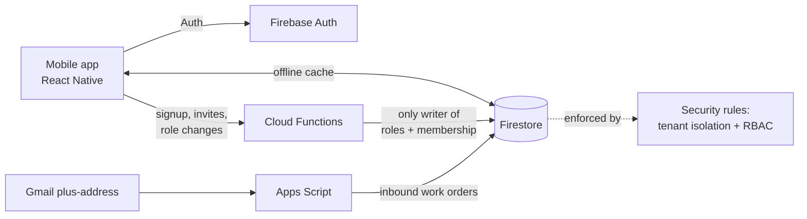

# Janitorial Operations Mobile App

> A multi-tenant mobile app for janitorial crews: supervisors dispatch work orders, crews complete them behind a photo-and-comment proof gate, and shifts use geofenced clock-in. In daily use at a small cleaning company.

**Built for:** a local janitorial services company (freelance consulting project)
**When:** August 2026 – present
**Stack:** React Native + TypeScript (Expo) · Firebase Auth · Cloud Firestore (offline cache + security rules) · Firebase Cloud Functions (Node 22) · Google Apps Script · pdf-lib · Jest with the Firebase emulator · Android
**My role:** Designed, tested and deployed it. Built with Claude Code as an AI pair programmer.

> The code is the client's, so it stays private. This page describes what I built and how.

---

## What it does

- **Work orders.** Supervisors create and dispatch them; crews can't mark one complete without a photo and a comment.
- **Scheduling.** Shifts and templates, with **geofenced clock-in** and alerts when someone doesn't clock in.
- **Roles.** Separate supervisor and employee screens, with a supervisor role for approvals and scheduling.
- **Onboarding paperwork.** Fills new-hire forms (including W-4 and I-9) as PDFs with e-signature.
- **Invites.** New employees join a workspace with an invite code.
- **Verification queue.** Completed work orders produce draft summary emails for a supervisor to review.
- **Inbound work orders by email**, using Gmail plus-addressing and Google Apps Script.
- **Audit log** per workspace.

## Multi-tenant by design

Tenancy is **data, not code**. Each workspace's settings live in a Firestore collection and are passed into screens and services, so there's no hard-coded list of customers and no branching on customer IDs.

**Security model**
- User roles and workspace membership can only be written by Cloud Functions. Every client is denied write access to them in the rules, which is what makes an invite mean something.
- Tenant isolation and role-based access are enforced in Firestore security rules, not just hidden in the UI.
- Pricing fields are blocked three times: the form hides them, the service strips them, and the rules reject them.
- Point-in-time recovery is enabled on the database.

## Testing

An automated suite of **33 test files**: 26 unit tests, 2 security-rules suites run against the Firebase emulator, and 5 Cloud Function tests.

## Results

- In production at the client for scheduling, work orders and timekeeping; built to grow from 3 employees to 10–15.

## Roadmap

1. Core workflow app, Android first (in progress)
2. A voice-controlled assistant on a dedicated tablet that uses the app (not started)
3. Field beta
4. Web and iOS

---

*See my [profile](https://github.com/Matteoinfl) for my other projects.*
